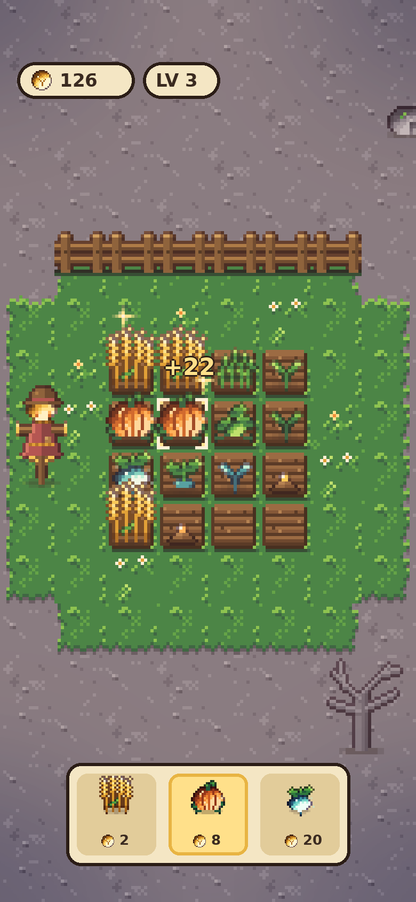

# DUSTBLOOM

*Grow your army.* An online pixel-art farming game for iPhone: crops from your farm
build combat scarecrows, communities fight wars over the map.



**Status:** stage 0, the skeleton. You can till the wasteland, plant three crops,
watch them grow and harvest them. Offline by default; can sync with the dev server.

## Layout

| Path | What |
| --- | --- |
| `client/` | iPhone app, Swift + SpriteKit + SwiftUI. Project generated by XcodeGen from `client/project.yml` |
| `server/` | Game server in Go (standard library only). Authoritative farm rules and JSON API |
| `server/internal/game/data/crops.json` | Balance file, shared by server and client |
| `art/` | Sprite generator, source logo, previews |
| `docs/` | Style guide and developer notes |
| `scripts/ios.sh` | Build, test and TestFlight upload on a Mac |

## iPhone app (on a Mac)

Needs Xcode 15 or newer and Homebrew.

```sh
scripts/ios.sh setup                 # installs XcodeGen, generates client/Dustbloom.xcodeproj
open client/Dustbloom.xcodeproj      # run on a simulator or your iPhone
scripts/ios.sh test                  # unit tests on a simulator
```

For TestFlight, create `client/.env.local` (it is ignored by git):

```sh
DEVELOPMENT_TEAM=ABCDE12345          # your Apple Team ID
BUNDLE_ID=game.dustbloom.app
```

Then create the app record once in App Store Connect with the same bundle id and run:

```sh
scripts/ios.sh testflight
```

## Server

```sh
cd server
go test ./...
go run ./cmd/dustbloom-server -addr :8080 -data dev-state.json
```

To play against it from the simulator, set `DUSTBLOOM_SERVER_URL=http://localhost:8080`
in the Dustbloom scheme's environment variables. A green dot in the HUD means online.

## CI

There is deliberately no GitHub Actions workflow: iOS builds and tests run on the Mac,
server tests run locally. This keeps GitHub minutes at zero.

## Rights

This repository is public for convenience, but it has no open-source licence.
All code and art are © the DUSTBLOOM authors, all rights reserved.
Copying, redistributing or reusing any part requires written permission.
